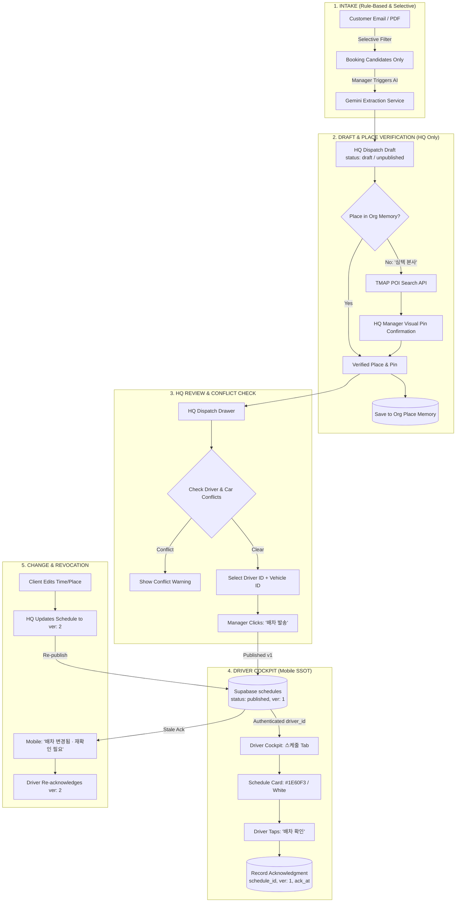

# Phase 0 Code Audit & Phased Implementation Proposal

**Reference Issue:** [#25 — [A01 → A02 MASTER PLAN] Customer email/schedule → HQ review → verified places → driver 스케줄](https://github.com/Junebooky/driver-eta-notifier/issues/25)  
**Deliverable Type:** Architectural Audit, Data Flow Map, Smallest Schema Contract & Phased Proposal (Planning Only — Zero Code Changes in P0)  
**Author:** A02 (Pair Programming with User)  
**Status:** Ready for Owner Review & Phase 1 Approval  

---

## 1. Executive Summary & Context

Issue #25 defines the operational pipeline for VIP Limousine Korea:
> **Client sends email/PDF/schedule** (often name-only, e.g., "심텍 본사" with no address) ➔ **HQ creates an editable draft** ➔ **Manager verifies place/time & selects authenticated driver + vehicle** ➔ **Manager taps "배차 발송"** ➔ **Only that assigned driver sees the published schedule in Cockpit's `#1E60F3`/white UI** ➔ **Driver taps "배차 확인" (versioned acknowledgment)** ➔ **Material changes trigger re-acknowledgment**.

### Core Constraints & Invariants
1. **Brand Consistency**: Adhere strictly to the Driver Cockpit design system: Cobalt Blue (`#1E60F3`), clean white surfaces, standardized typography, rounded cards (`rounded-2xl`), and mobile-friendly touch targets.
2. **Never Silently Geocode**: A name-only or ambiguous location must **never** be assigned guessed coordinates or auto-dispatched to navigation. It must be explicitly verified or flagged as `위치 확인 필요`.
3. **Draft ≠ Published**: Parsing an email or uploading a PDF must write to an **unassigned, unpublished draft** visible only in HQ. It must **never** auto-publish into a driver's live mobile schedule.
4. **No Demo Fallback as Real Work**: Remove all `CONFIRMED_FERRARI_SCHEDULES` fallback leaks in production. Empty or errored states must report clean, honest states.
5. **No Cross-Driver Data Exposure**: Schedules must be scoped to authenticated `driver_id` and `org_id`, not bypassable client query parameters like `?vehicle_no=4호차`.

---

## 2. Phase 0 Codebase Audit (Current State vs. Required Architecture)

### 2.1. `app/api/schedules/route.ts` (Driver Schedule CRUD)
* **Current Implementation**:
  - GET queries Supabase `schedules` by `vehicle_no` from query param (`?vehicle_no=4호차` or `?vehicle_no=all`).
  - **Critical Defect (Demo Leak)**: If the database is empty or queries error out, lines 80–91 fall back to returning `CONFIRMED_FERRARI_SCHEDULES` for `4호차` and `all`.
  - **Critical Defect (Auth Boundary)**: There is zero driver identity validation. Any client can pass any `vehicle_no` and view another driver's passenger names, flight numbers, and itineraries.
  - **Missing Fields**: Lacks `driver_id`, `org_id`, `version`, `dispatch_status` (`draft` vs `published`), `ack_status`, `ack_at`, `passenger_phone`, and `place_verified`.
* **Action Required in P1**:
  - Restrict queries to the authenticated session (`driver_id` for mobile drivers, manager role for HQ).
  - Strip the `CONFIRMED_FERRARI_SCHEDULES` fallback completely.
  - Filter mobile queries strictly to `dispatch_status = 'published'`.

---

### 2.2. `app/api/schedule/parse/route.ts` (PDF/Image Gemini Parsing)
* **Current Implementation**:
  - Parses uploaded PDF/image via Gemini 2.5 Flash and resolves places using fuzzy regex and TMAP POI search.
  - **Critical Defect (Immediate Live Upsert)**: Lines 498–508 call `supabaseAdmin.from('schedules').upsert(upsertRows)` directly. This immediately publishes unreviewed AI guesses into the live schedule feed.
  - **Critical Defect (Silent Geocode & Fabricated Defaults)**:
    - Line 114: Empty names silently default to coordinates `37.5042, 127.0425`.
    - Line 482: Missing passenger names default to `'VIP 고객님'`.
    - Line 118–125: Fuzzy string matching guesses locations based on partial substrings.
* **Action Required in P3**:
  - Decouple parsing from live `schedules`. Parsing must write to a `dispatch_drafts` table or return an uncommitted draft payload to the HQ manager drawer.
  - Eliminate invented default coordinates. Mark unmatched places as `needs_resolution: true`.

---

### 2.3. Mobile Cockpit: `components/ScheduleTab.tsx` & `ScheduleCard.tsx`
* **Current Implementation**:
  - Renders cards with pickup times, route connectors, flight numbers, passenger names, and navigation action buttons.
  - Beautiful visual foundation matching `#1E60F3` and white aesthetics.
  - **Missing Capability**: No `배차 확인` (acknowledgment) interaction. Drivers cannot acknowledge assignments, and managers cannot see who confirmed.
  - **Missing Capability**: No indicator for unverified locations (`위치 확인 필요`) or schedule update notices (version updates).
* **Action Required in P1 & P5**:
  - Add primary `[배차 확인]` action button to `ScheduleCard` when assignment is pending driver acknowledgment.
  - Add version badge (`v2 수정 배차`) and notification banner for updated dispatches.

---

### 2.4. HQ Operations Dashboard: PR #19 (`feat/hq-dashboard`) & PR #22 (`feat/hq-customer-management`)
* **Current Implementation**:
  - PR #19 delivers the full desktop UI at `/hq`: KPI tiles, dispatch table, quick dispatch form (`HqQuickDispatch`), and booking drawer (`HqBookingDetailModal`).
  - PR #22 adds the CRM Customer Management preview tab (`/hq?tab=customers`).
  - Inbound email UI (`HqEmailInboxView.tsx`) and extraction API (`/api/email/extract-booking`) exist, but rely on deterministic mock data for email parsing.
  - **Gap**: "배차 발송" in `HqQuickDispatch` only manipulates client-side mock state (`HqBooking[]`). It does not persist to database or trigger driver schedule delivery.
* **Action Required in P1 & P2**:
  - Connect `HqQuickDispatch` and `HqBookingDetailModal` to Supabase `dispatches`/`schedules`.
  - Add place verification checks before enabling the "배차 발송" button.

---

### 2.5. Database & Row-Level Security (`supabase/migrations/`)
* **Current Implementation**:
  - Migration `20260922_init_cockpit.sql` defines `cockpit_schedules`, `cockpit_drivers`, and `cockpit_presets`.
  - **Security Risk**: RLS policies for all three tables are set to:
    ```sql
    CREATE POLICY "Allow all on cockpit_schedules" ON public.cockpit_schedules FOR ALL USING (true) WITH CHECK (true);
    ```
    This allows unauthenticated read and write access across the entire database.
* **Action Required in P1**:
  - Introduce tenant/organization isolation (`org_id`).
  - Restrict mobile drivers to reading only assignments where `driver_id = auth.uid()`.
  - Restrict write operations (`INSERT`, `UPDATE`, `DELETE`) to verified managers.

---

## 3. End-to-End Data Flow Architecture



---

## 4. Place Resolution Architecture (“심텍 본사” Problem)

A critical requirement is that ambiguous, name-only places are never silently geocoded or dispatched with guessed coordinates.

```
[Customer Email: "심텍 본사"]
       │
       ▼
[Step 1: Check Org Place Memory (cockpit_presets / org_places)]
       ├─► MATCH FOUND ──► Auto-populate verified address & exact gate pin.
       │
       ▼ (NOT FOUND)
[Step 2: Query TMAP POI Search API]
       ├─► Candidate 1: ㈜심텍 청주공장 (충북 청주시 흥덕구 산단로 73)
       ├─► Candidate 2: 심텍 서울사무소 (서울 강남구 테헤란로)
       ├─► Candidate 3: 심텍 본사 (오창과학산업단지)
       │
       ▼
[Step 3: HQ Manager Confirmation Dialog in HQ Drawer]
       ├─► Manager selects matching candidate OR adjusts pin on Kakao/TMAP map.
       ├─► System flags: "위치 확인 완료 (검증자: 관리자)"
       │
       ▼
[Step 4: Persistence for Future Reuse]
       └─► Add alias "심텍 본사" -> Verified address & lat/lng into Org Place Memory.
```

### Safety Guard
If the manager does not confirm an address:
- The draft retains status: `needs_place_resolution: true`.
- The `[배차 발송]` button remains **disabled**.
- Attempting to publish shows: `"미확인 장소가 포함되어 있어 배차를 발송할 수 없습니다. 주소 및 핀을 확정해주세요."`
- The mobile driver is **never** dispatched with inaccurate GPS coordinates.

---

## 5. Smallest Safe Schema Contract (Supabase)

To support this pipeline without breaking existing mobile Cockpit features, we propose minimal, non-breaking schema extensions:

### 5.1. `schedules` Table (Extension of Existing Schema)
```sql
-- Non-breaking additive columns for schedules
ALTER TABLE public.schedules
  ADD COLUMN IF NOT EXISTS org_id UUID DEFAULT '00000000-0000-0000-0000-000000000001',
  ADD COLUMN IF NOT EXISTS driver_id UUID,                -- Authenticated driver link
  ADD COLUMN IF NOT EXISTS vehicle_id UUID,               -- Canonical vehicle link
  ADD COLUMN IF NOT EXISTS dispatch_status TEXT DEFAULT 'draft', -- 'draft' | 'published' | 'cancelled'
  ADD COLUMN IF NOT EXISTS version INTEGER DEFAULT 1,     -- Revision counter
  ADD COLUMN IF NOT EXISTS place_verified BOOLEAN DEFAULT false,
  ADD COLUMN IF NOT EXISTS passenger_phone TEXT,
  ADD COLUMN IF NOT EXISTS published_at TIMESTAMPTZ,
  ADD COLUMN IF NOT EXISTS published_by UUID,
  ADD COLUMN IF NOT EXISTS last_ack_version INTEGER DEFAULT 0,
  ADD COLUMN IF NOT EXISTS last_ack_at TIMESTAMPTZ;

-- Performance index for driver schedule feed
CREATE INDEX IF NOT EXISTS idx_schedules_driver_feed
ON public.schedules (driver_id, date, pickup_time ASC)
WHERE dispatch_status = 'published';
```

### 5.2. `dispatch_acknowledgments` Table (Audit Trail)
```sql
CREATE TABLE IF NOT EXISTS public.dispatch_acknowledgments (
  id UUID PRIMARY KEY DEFAULT gen_random_uuid(),
  schedule_id UUID NOT NULL REFERENCES public.schedules(id) ON DELETE CASCADE,
  version INTEGER NOT NULL,
  driver_id UUID NOT NULL,
  driver_name TEXT NOT NULL,
  acknowledged_at TIMESTAMPTZ DEFAULT now(),
  device_summary TEXT, -- e.g. "Safari Mobile (iOS 18)"
  UNIQUE (schedule_id, version, driver_id)
);
```

### 5.3. `org_places` Table (Organization Place Memory & Aliases)
```sql
CREATE TABLE IF NOT EXISTS public.org_places (
  id UUID PRIMARY KEY DEFAULT gen_random_uuid(),
  org_id UUID NOT NULL,
  name TEXT NOT NULL,               -- e.g. "심텍 본사 (오창)"
  aliases TEXT[] DEFAULT '{}',      -- e.g. ["심텍", "심텍 본사", "Simmtech HQ"]
  road_address TEXT NOT NULL,       -- e.g. "충북 청주시 청원구 오창읍 양청3길 39"
  lat DOUBLE PRECISION NOT NULL,
  lng DOUBLE PRECISION NOT NULL,
  entry_gate_notes TEXT,            -- e.g. "정문 경비실에서 의전 차량 방문증 수령"
  created_at TIMESTAMPTZ DEFAULT now(),
  updated_at TIMESTAMPTZ DEFAULT now()
);
```

---

## 6. Phased Implementation Roadmap (P0 to P5)

Each phase will be developed in an **isolated branch** with a **Draft PR** and must receive owner approval before moving to the next.

| Phase | Title | Scope & Deliverables | Approval Gate |
|---|---|---|---|
| **P0** (Now) | **Audit & Contract** | Codebase audit of `main`, PR #19, and PR #22; data flow mapping; risk identification; and contract design. **Zero production code changes.** | Owner review of this proposal |
| **P1** | **Secure HQ Manual Dispatch & Driver Mobile Ack** | Connect `HqQuickDispatch` to database with explicit `[배차 발송]`. Update mobile `ScheduleTab` to query by authenticated `driver_id`. Remove Ferrari demo fallback on empty/error. Implement `[배차 확인]` button and acknowledgment audit trail. No email dependency yet. | Owner approval of P1 Draft PR |
| **P2** | **Verified Place Memory & TMAP Resolution** | Implement `org_places` memory table + TMAP POI search integration in HQ drawer. Add visual map pin confirm tool for HQ managers. Implement publish guard (`위치 확인 필요` blocks dispatch). | Owner approval of P2 Draft PR |
| **P3** | **Gemini Schedule & Email Text Extraction (Draft Only)** | Refactor `/api/schedule/parse` and `/api/email/extract-booking` so Gemini output **strictly populates uncommitted HQ drafts**. Strip direct upserts to live schedules. Eliminate invented names and coordinates. | Owner approval of P3 Draft PR |
| **P4** | **Selective NAVER/Gmail Inbound Intake** | Implement rule-based email shortlisting (filter out spam/promotional mail). Only fetch and parse candidate booking emails upon explicit manager opt-in. Implement deduplication based on email Message-ID to prevent duplicate drafts. | Owner approval of P4 Draft PR |
| **P5** | **Versioned Updates & Change Notification** | Implement version increments on itinerary changes. Flag stale driver acknowledgments in HQ checklist (`재확인 필요`). Add "배차 변경됨" banner in Cockpit. Mobile end-to-end QA. | Final acceptance & merge approval |

---

## 7. Must-Pass Verification & Risk Matrix

| Risk Scenario | Prevention Mechanism in Proposed Design | Verification Test in QA |
|---|---|---|
| **Silent Geocoding Error** | Places without exact match require explicit HQ manager pin confirmation. | Submit "심텍 본사" with no address ➔ verify system marks `위치 확인 필요` and disables `배차 발송`. |
| **AI Schedule Auto-Publish** | Gemini endpoints write to `dispatch_drafts` only, never to `schedules`. | Upload test PDF via `/api/schedule/parse` ➔ verify 0 rows added to driver mobile feed until HQ manually dispatches. |
| **Demo Schedule Leak** | Hardcoded Ferrari schedule fallback removed from API routes. | Query API with new vehicle number or clean database ➔ verify empty array returned, zero Ferrari items shown. |
| **Cross-Driver Data Breach** | Supabase query restricted to authenticated `driver_id`. | Driver 1 attempts to query `?driver_id=driver_2` ➔ verify 403 Forbidden / empty response returned. |
| **Stale Dispatch on Changes** | Itinerary changes increment `version` and reset `last_ack_version`. | Manager modifies pickup time from 09:00 to 10:00 ➔ verify driver card shows `[재확인 필요]` and HQ flags unacknowledged. |
| **Duplicate Email Bookings** | Inbound intake checks email `message_id` and existing thread links. | Sync inbox with duplicate email ➔ verify only 1 draft created, subsequent syncs skip duplicate. |

---

## 8. Summary & Recommendation

1. **Phase 0 Status**: Audit complete. Key vulnerabilities and architectural gaps in existing code (`CONFIRMED_FERRARI_SCHEDULES` leak, direct AI upsert, unverified geocoding, and unauthenticated query param filtering) have been documented.
2. **Next Step**: Await user approval on this Phase 0 proposal to initiate **Phase 1** (`feat/secure-hq-manual-dispatch` branch) to build the core secure manual dispatch and mobile driver acknowledgment loop without email dependency.
