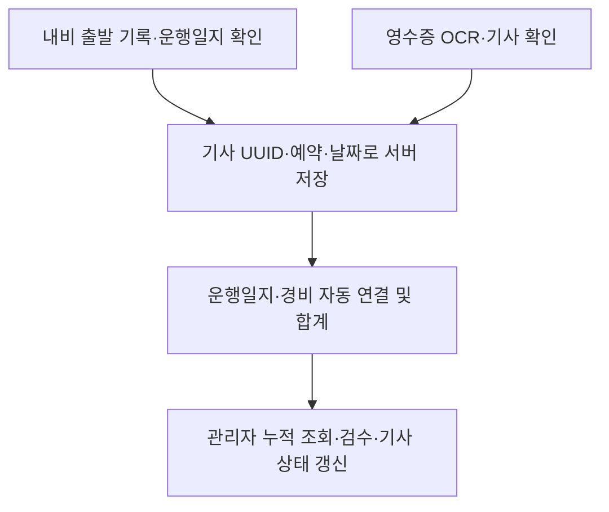

# 운행일지 → 영수증 → 관리자 누적 연결 점검

## 현재 판정

운영 서비스에서 이미 연결 완료된 상태는 아니다. 2026-10-31 읽기 전용 확인에서 `cockpit.driving_logs`, `cockpit.expenses`가 존재하지 않았다. 비공개 `cockpit-assets` 버킷은 실제로 존재하며 JPEG/PNG/WebP/PDF를 허용한다. 운영 테이블/데이터/계정은 이 작업에서 변경하지 않았다.

PR #40에서 아래 연결을 수정했다. SQL 제안과 실제 Postgres 기반 연결 검증도 함께 제공한다. 최종 CI 완료 여부는 PR의 최신 커밋 체크를 기준으로 확인한다.

## 발견한 단절과 수정

| 단절 | 수정 |
| --- | --- |
| 영수증 자동 제출이 로컬 목록만 갱신하고 고정 기사명/차량을 사용 | 기사 확인 후 원본 비공개 업로드와 실제 경비 API 호출을 기다린다. 실패하면 편집창과 미제출 초안을 유지한다. |
| 파일명에 `cu`/`fuel`이 있거나 파일 크기가 같으면 다른 샘플 금액을 적용 | 실제 업로드에는 OCR을 수행한다. 캐시는 원본 전체의 SHA-256으로 구분한다. 샘플 지출/운행일지는 본사 제출을 차단한다. |
| 로컬 이미지 주소만 저장되어 다른 기기에서 원본을 볼 수 없음 | 비공개 Storage 경로를 저장하고, 경비 소유권을 검증하는 이미지 API로 조회한다. 이미지 프록시는 권한 쿠키를 유지하며 응답은 no-store다. |
| 임시 경비 ID가 매번 다른 서버 UUID가 되어 중복 저장 | 편집기 생성 시 UUID를 고정한다. 업로드는 내용 해시 경로로 재사용하며, 경비는 같은 UUID로 재확인한다. 저장 응답 개수/ID도 검증한다. |
| 내비 기록과 운행일지 창이 서로 다른 초안을 열거나 다른 기사의 캐시를 읽음 | 기사 UUID·예약·날짜별 초안을 공유한다. 서버 ID와 제출 상태를 유지하고, 재실행/온라인 복귀 때 대기 중인 본인 기록을 재전송한다. 인증 오류로 대기 기록을 버리지 않는다. |
| 제출 때 고객사·시간·주행거리 예시값을 대입 | 실제 입력값만 전송한다. 확인되지 않은 도착 시간/거리를 예측값으로 확정하지 않는다. 탑승객 수도 저장한다. |
| 브라우저별 이름/차량 매칭으로 경비 합계를 계산 | 같은 조직·기사 UUID·예약·운행 날짜의 경비만 DB에서 연결/집계한다. 영수증/운행일지 중 무엇을 먼저 저장해도 맞물린다. 반려·초안 비용은 집계에서 제외한다. |
| 관리자의 다른 기기에서 새 경비가 자동으로 나타나지 않음 | 서버 재조회, 20초 간격 갱신, 포커스/온라인 복귀 갱신을 적용한다. 빈 서버 응답도 그대로 반영하고 초기 샘플을 실제 누적 내역처럼 표시하지 않는다. |
| 오늘·이번 달 KPI가 전체 기간 금액을 표시 | 실제 한국 날짜를 기준으로 집계한다. 대시보드에 같은 DB의 전체 누적 운행·거리·경비·검수 대기 요약을 추가했다. |

원시 Hi-Pass 거래를 브라우저에서 추정한 고객사/기사에 끼워 넣던 자동 병합은 사용하지 않는다. 검증된 경비 테이블이 집계 기준이다. Hi-Pass 원장과 청구 경비로의 확정 매핑은 별도 기능이다.

## 검증 범위

- 오프라인 단위 테스트: 기사별 초안/경비 격리, 같은 초안 재열기, 제출 상태 유지, 경비 UUID 재시도, JSON에서 원본 base64 제외, 부분 응답 거부, 서버 0건 반영, 날짜별 KPI, 관리자 집계 권한/DB 장애 응답.
- 프로덕션 HTTP smoke: 개인 계정 인증, 세션 갱신·철회, 사용자 격리 및 내부 API 보호. Auth/PostgREST fixture를 사용한다.
- `tests/reporting-flow.integration.ts`: 제품의 실제 제출 helper와 API handler를 실제 localhost Postgres에 연결한다. Storage/Auth는 격리 fixture다. 원본 업로드 실패, 업로드/경비 재시도, 영수증 먼저 저장, 운행일지 먼저 저장, 다른 기기 ID로 재제출, 서로 다른 예약 분리, DB 자동 합계, 관리자 요약/원본/승인, 기사 승인 상태 재조회, 타 기사 차단, 마지막 행 실패 전체 롤백, 반려/삭제 후 재집계를 검사한다.
- 실제 Supabase의 새로운 SQL 설치, 실제 OCR 제공자 정확도, 휴대폰 화면/브라우저 조작은 이 검증을 대신하지 않는다.

## 운영 적용에 필요한 구체적인 항목

1. 기존 배차·개인 인증 선행 제안을 검토한다. 개인 Auth 계정을 실제 기사 UUID와 연결해야 한다. [개인 인증 적용/복구 계획](PERSONAL_AUTH_RELEASE_PLAN.md)을 따른다.
2. `20261031033709_reporting_flow_integrity.sql`을 스테이징에서 검증한다. 이 파일은 과거 `20261029_cockpit_driving_logs_and_expenses.sql`의 테이블 제안을 대체하는 독립 reporting 제안이다. 두 파일을 폴더 전체 재생 방식으로 중복 적용하지 않는다.
3. 기존 reporting 데이터가 있는 환경은 논리 키가 같은 중복 행을 먼저 조사한다. 고유 인덱스 생성 실패를 데이터 삭제로 해결하지 않는다. 데이터가 없는 현재 운영 환경에도 소유자 승인 없이 적용하지 않는다.
4. 실제 기사 두 계정과 HQ 계정으로 모바일 업로드 → 저장 → 다른 기기 관리자 조회 → 검수 → 기사 재조회까지 확인한다. 실제 영수증은 공개 버킷/PR에 올리지 않는다.
5. 운영 SQL 적용·계정 연결·배포 후 위 흐름을 확인해야 운영 연결 완료로 판정할 수 있다. SQL과 코드 준비만으로 실운영 완료를 선언하지 않는다.
